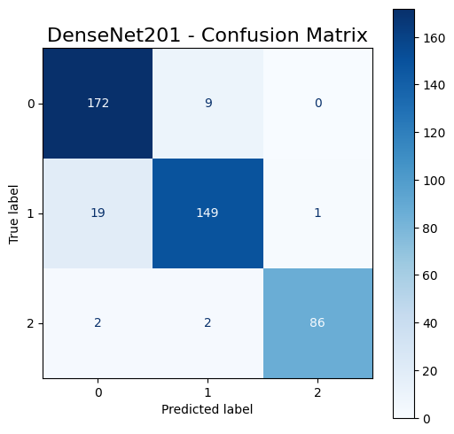

<div align="center">

# DenseNet201 with Squeeze-and-Excitation for Skin Lesion Classification

**Experimental notebook from the research behind *Skin Lesion Classification with Explainable AI to Enhancing Dermatological Diagnosis* (IEEE MECON 2025).**

[](https://doi.org/10.1109/MECON67253.2025.11277079)
[](#publication)
[](https://pytorch.org/)
[](LICENSE)

</div>

> [!IMPORTANT]
> This is research code, not a diagnostic tool. It must not be used for clinical decisions.

## Publication

**Skin Lesion Classification with Explainable AI to Enhancing Dermatological Diagnosis**
Md Serajun Nabi, Md Rashidul Islam, Bakary Gibba, Raihana Mohammadi, M. Touhami, M. F. Ahmad Fauzi
*2025 Multimedia University Engineering Conference (MECON)*, IEEE, pp. 1–6. [doi:10.1109/MECON67253.2025.11277079](https://doi.org/10.1109/MECON67253.2025.11277079)

This repository contains the DenseNet201 + SE classification experiment. The explainability (XAI) analysis reported in the paper is not included in this notebook.

## Dataset

[PH² dermoscopic image dataset](https://www.kaggle.com/datasets/rashidul0/ph2-skin-cancer-classification): 200 dermoscopy images in three classes, namely 80 common nevi, 80 atypical nevi and 40 melanomas. The dataset is not redistributed here.

## Method

| Component | Details |
| --- | --- |
| Backbone | DenseNet201, ImageNet-pretrained (torchvision) |
| Attention | Squeeze-and-Excitation block (reduction 8) on the 1920-channel feature map |
| Loss | Focal loss for class imbalance |
| Augmentation | Offline: original plus 10 augmented copies per image (2,200 images: 880 / 880 / 440). Online: Mixup |
| Optimisation | OneCycleLR schedule, dropout, early stopping (patience 7), up to 50 epochs |
| Input | 224 × 224 RGB, ImageNet normalisation |
| Split | Random 80/20 split of the augmented set (`manual_seed(42)`) |

## Results

Test set: 440 images from the augmented dataset.

| Class | Precision | Recall | F1 | Support |
| --- | ---: | ---: | ---: | ---: |
| Atypical nevus | 0.86 | 0.92 | 0.89 | 181 |
| Common nevus | 0.92 | 0.85 | 0.89 | 169 |
| Melanoma | 0.98 | 0.98 | 0.98 | 90 |
| **Accuracy** | | | **0.91** | 440 |
| Macro average | 0.92 | 0.92 | 0.92 | 440 |



Labels follow torchvision's alphabetical folder order: 0 = atypical nevus, 1 = common nevus, 2 = melanoma. Most errors are between the two nevus classes, which are also the hardest to separate clinically.

### Notes on evaluation

- The 80/20 split is drawn **after** offline augmentation, so augmented copies of the same lesion can appear in both training and test sets. This likely makes the reported accuracy optimistic. Splitting by original image before augmentation, or cross-validating at image level, would give a stricter estimate.
- PH² is small (200 images) and comes from a single clinical source, so results may not transfer to other dermoscopy devices or populations.

## Repository Contents

| File | Purpose |
| --- | --- |
| [`densenet201-se-skin-lesion.ipynb`](densenet201-se-skin-lesion.ipynb) | Augmentation, model, training and evaluation (Kaggle notebook) |
| [`figures/`](figures/) | Confusion matrix exported from the notebook |
| [`CITATION.cff`](CITATION.cff) | Citation metadata for the paper |

## Reproducing

The notebook was run on Kaggle with the PH² dataset attached as an input. To run it elsewhere, update `ORIG_DATA_DIR` and `AUG_DATA_DIR` in the notebook.

## Citation

```bibtex
@inproceedings{nabi2025skin,
  author = {Md Serajun Nabi and Md Rashidul Islam and Bakary Gibba and Raihana Mohammadi and M. Touhami and M. F. Ahmad Fauzi},
  title = {Skin Lesion Classification with Explainable AI to Enhancing Dermatological Diagnosis},
  booktitle = {2025 Multimedia University Engineering Conference (MECON)},
  pages = {1--6},
  year = {2025},
  publisher = {IEEE},
  doi = {10.1109/MECON67253.2025.11277079}
}
```

---

<div align="center">

**Part of [Bakary Gibba's AI engineering portfolio](https://github.com/BakaryGibba/bakary-gibba-ai-engineering-portfolio)**

[Portfolio website](https://bakary-gibba.vercel.app/) · [LinkedIn](https://www.linkedin.com/in/bakary-gibba-6409bb248/) · [Google Scholar](https://scholar.google.com/citations?user=bp0G4sgAAAAJ&hl=en)

</div>
